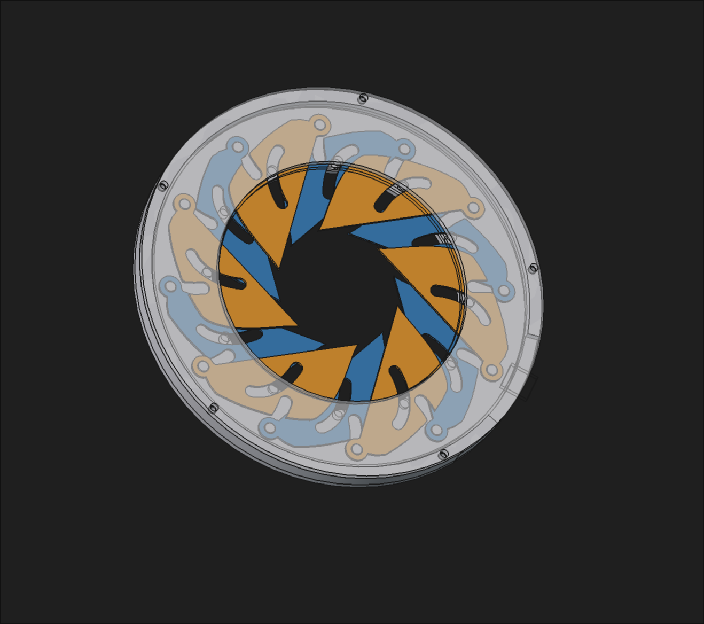
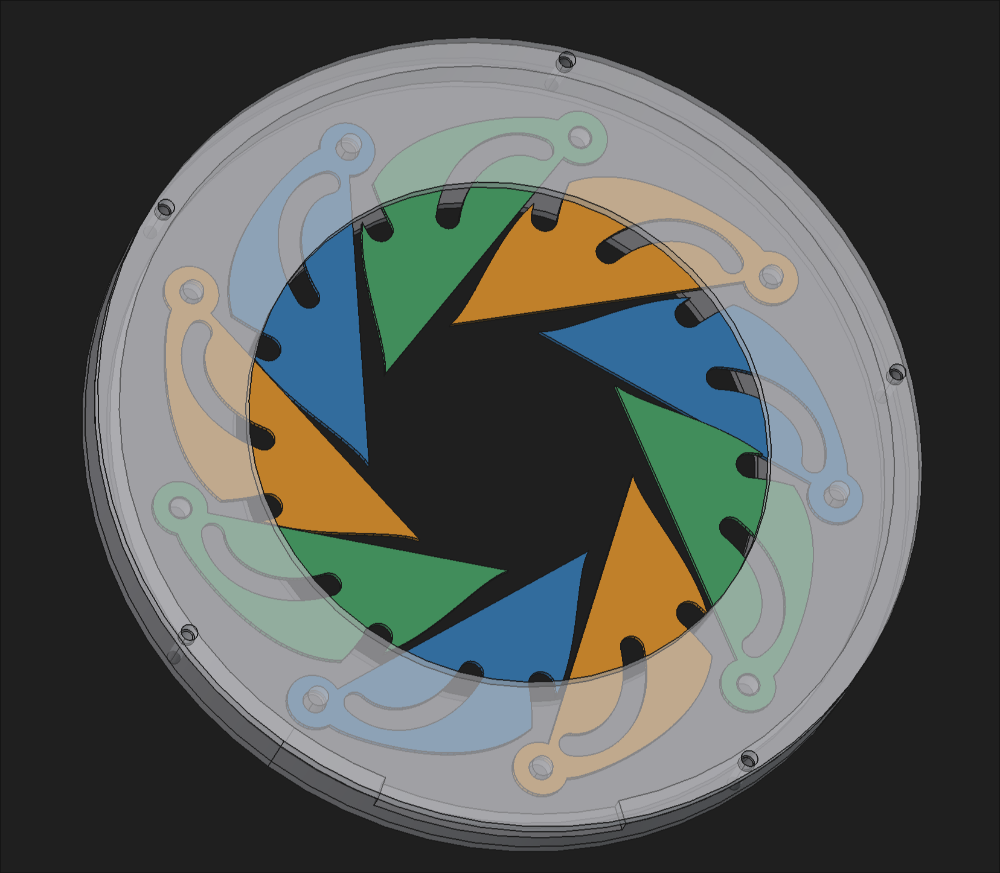
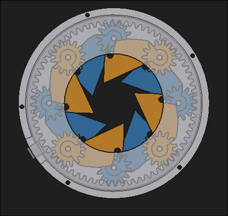

# iris

this is my half life week 2 project, iris. iris is a mechanical iris diaphragm, similar to the aperture in some cameras. there's only the printable version and design for the final version in this repository, but there's photos of past versions as well as a fun semicircle blade model in [dev-log-2](./dev-log-2/). 

i wanted to build iris because i really liked the mechanical variable aperture in older camera lenses, and building one myself would be an interesting cad project as well. 

the finished version ^

v1&v2:

